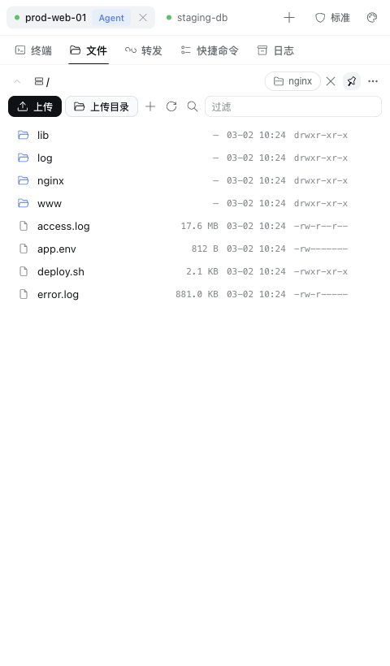
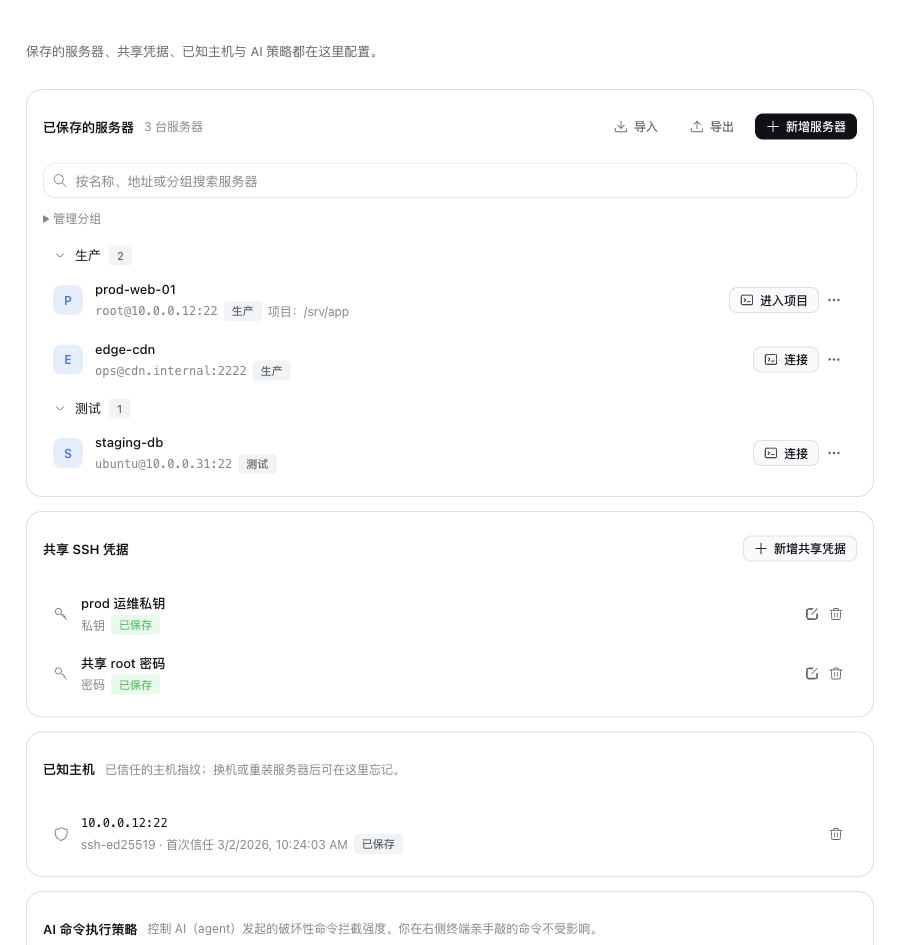

# Harbor — remote operations workbench

An SSH workbench for DeepSeek Harness: **drive a server from the conversation while a real interactive terminal stays open beside it**. Live machine status, files, port forwarding, snippets and session logs share the same panel as the chat.


> A remote machine is a first-class object, not a line in a script.


## Quick start

```bash
git clone https://github.com/DaozeTang/dsh-harbor.git
cd dsh-harbor
npm install
dsh plugin --profile web add "$PWD"
dsh web
```

Open any session, click the terminal button in the header and connect a server in the Harbor tab. Setup lives in [INSTALL.md](./INSTALL.md); each panel is covered in the [product guide](./docs/product-guide.md).

> **DSH 0.2.3+**: interactive terminals reuse the official Persistent terminals plugin and its `terminal_*` tools. Keep that plugin enabled; without it `ssh_exec`, files, tunnels, logs and status still work, but the agent has no interactive SSH terminal.

## What it solves

Reaching a remote machine usually takes three windows: a terminal, an SFTP client, and a chat where commands get copied in and results pasted back. Harbor puts all of it on one screen:

- **One terminal per conversation, with the agent working beside you.** Say "check memory"; the command runs in the terminal in front of you, and exit code, output, duration, timeout and truncation state come back to the model unchanged. Two conversations on the same machine never type over each other.
- **Credentials never enter the conversation.** Servers are saved as resources; passwords and keys go only to DSH's local credential store. The model sees "the shared credential of prod-web-01", never the secret.
- **Destructive actions need your approval.** Commands that hit the safety rules suspend the tool call for a native in-session approval. An approved `rm` performs a reversible move into a remote trash directory instead of a delete.

## Screens

| | |
| --- | --- |
| Status overview |  |
| Terminal and files |  |
| Servers and policy |  |

## Features

**Status.** CPU (total, load, per core), memory and swap, disk usage and I/O, network throughput, NVIDIA GPUs, the busiest processes, and this connection's coordinates and sampling cost — on one screen. Readings come from one fixed, read-only probe on the host (`/proc`, `df`, `ps`, `nvidia-smi`), every 2 seconds by default; polling stops when you leave the tab, collapse the sidebar or hide the window, and can be paused or slowed to 5/10 seconds. When a host cannot be sampled it says why — non-Linux remotes, network devices without an exec channel, an exhausted sshd MaxSessions — and never shows 0 as a reading. "Copy snapshot" turns the current readings into text you can paste into the chat.

**Terminal.** A first-class tab in the DSH right sidebar; split, zoom, fullscreen and collapse are DSH's own. Switching tabs, collapsing the sidebar or changing chats never disconnects — terminal instances stay pooled and the host replays buffered output. Find (`Ctrl/⌘+F`, `Shift+Enter` for previous), copy-on-select, `Ctrl+wheel` zoom, jump-to-bottom. Each pane keeps its own server and selection; the same server in both panes gives two independent channels. The connection the agent is bound to carries an "Agent" badge — click the other pane to move it. Host fingerprints are TOFU: recorded on first connect, rejected on change (`accept-new` / `verify` / `off`).

**Files.** SFTP browsing, uploads (drag and drop, directory merge), streamed downloads, rename, deletion confirmed in the panel (agent deletes go through recoverable remote trash), and a text editor that verifies the original content before saving and never leaves a backup file on the remote host. Remote search, favourites, cancellable transfers, and "open this directory in the terminal".

**Tunnels.** Local, remote and dynamic SOCKS5 forwarding, with live bound ports and connection counts. Tunnels live and die with their connection.

**Snippets.** Built-in ops commands plus your own; clicking only fills the terminal input line — Enter is still yours. `{{parameters}}` and global / group / server scoping.

**Session logs.** Every terminal session leaves a host-side recording; the panel reads it in bounded chunks, searches, downloads plain text and deletes per record. Secrets are redacted before anything reaches the model.

**Resources and policy.** Groups, search, shared credentials, jump chains (up to 8 hops), OpenSSH import, encrypted backup export/import, and three execution-policy tiers that can be loosened for a session but never persist. Importing `~/.ssh/config` carries each host's `IdentityFile` private key along, and key pickers accept extensionless files. Fixed remote project directories and workspace bindings land the agent's `sftp_*` calls in the right remote directory.

## Security model

The host's own permission system comes first; Harbor only adds to it.

1. **Secrets stay local**, in `~/.dsh/.credentials.yaml` (owner-only). Browser storage, agent context, tool results and resource lists never carry plaintext.
2. **Dangerous commands suspend the call** for a native approval: deletes, `terraform destroy`, `kubectl delete`, `docker prune`, forced Git cleanups, reboots, and their common bypasses (`find -exec rm`, `xargs rm`, one-liners that call `unlink`). An approval covers exactly that command on that machine.
3. **Agent deletes are reversible.** An approved `rm` moves the target into `~/.dsh-trash/` with its original path in the trash manifest; entries older than 24 hours are cleaned up opportunistically, and nothing is installed on the server. Deleting in the panel is an explicit permanent delete with its own confirmation.
4. **The agent sees only the current connection.** Connecting saved servers by name requires auto-connect to be enabled, and every such connection opens its terminal in the sidebar, so you always see which machine it is on.

The blacklist can never be complete — any script can hide a delete — so rule 3 backs recognition up with a reversible outcome.

## Agent tools

22 tools are registered by default; omitting `connection_id` targets the active connection. **Settings → Harbor → Features** can disable the tunnel, log and status tools (requires a DSH restart).

Interactive terminals are not Harbor tools any more. After connecting, the agent opens an SSH terminal through DSH's official persistent-terminal tools (`terminal_open` with type `harbor-ssh`) and drives it with `terminal_send`, `terminal_read`, `terminal_signal`, `terminal_close` and `terminal_list` — names, parameters, wait reasons and error codes come from the host. Harbor supplies the SSH backend only; the shell you watch in the side panel is the same session. Once you type into it, the agent can read but no longer write.

| Group | Tools |
| --- | --- |
| SSH (5) | `ssh_list` `ssh_connect` `ssh_connect_profile` `ssh_exec` `ssh_disconnect` |
| Terminal (host) | `terminal_open` (type `harbor-ssh`) `terminal_send` `terminal_read` `terminal_signal` `terminal_close` `terminal_list` |
| Files (9) | `sftp_list` `sftp_read` `sftp_write` `sftp_mkdir` `sftp_rename` `sftp_delete` `sftp_upload_file` `sftp_upload_dir` `sftp_download_dir` |
| Tunnels (3) | `tunnel_start` `tunnel_stop` `tunnel_list` |
| Batch (1) | `ssh_batch` |
| Logs (3) | `ssh_session_log_list` `ssh_session_log_read` `ssh_session_log_search` |
| Status (1) | `ssh_status` |

Multi-host execution only goes through `ssh_batch`: the agent proposes the command, **you pick the targets** in the panel.

## Development

```
src/
  index.js               plugin entry: mounts Remote, registers tools / settings page / sidebar tab
  rpc/                   Typert contract: descriptors, schemas, host manifest, client contribution
  host/
    service/             connections, sessions, files, tunnels, streamed file routes
    tools/               agent-facing tool registration
    *.js                 pure logic: safety, trash, host keys, redaction, SFTP pipeline…
  client/
    index.jsx            browser entry: sidebar tab + settings section + header action
    HarborPanel.jsx      workbench shell (server strip, view switcher, panes)
    ui/                  design system: kit, icons, stylesheet
    features/            terminal, files, tunnels, logs, snippets, policy
    terminal-display/    terminal palettes, semantic highlighting, appearance settings
  i18n/                  zh/en message layer (Chinese is the source language)
```

```bash
npm install          # installs dependencies and builds (prepare hook runs build)
npm run build        # host + client + xterm stylesheet
npm test             # unit and integration tests (node --test)
npm run preview:ui   # offline preview pages in preview/out (DSH_THEME_CSS_DIR for live tokens)
npm run theme:snapshot -- <dsh-ui-theme>/src/styles  # refresh the offline token snapshot from DSH
npx eslint .
```

Preview pages accept `?capture` (a full-height surface screenshot) and `?bare` (hide only the preview header).

Design rules are in [docs/ui-guidelines.md](./docs/ui-guidelines.md); icons come from the host's own sprite (see [icon sources](./docs/icon-pipeline.md)).

## Compatibility

- Host: DSH `>= 0.2.0`, verified on `0.2.2-rc.5`.
- Requires the right sidebar (`sidebarRightTabs` + `sidebarRight`). Older hosts still run the agent tools but show no terminal UI, and there is no floating-panel fallback.
- Streamed uploads and downloads register only when the Web profile provides both `webServer` and request-origin validation; other hosts keep using plain SFTP.
- Uses DSH's bundled Node runtime; no system `ssh`, `sftp` or Node.js is required.
- Restart the profile after installing or upgrading. Resources, known hosts and credentials live in DSH's local storage, not in the package, so ordinary upgrades keep them.

## License

MIT, copyright Harbor contributors. Third-party notices in [THIRD_PARTY_NOTICES.md](./THIRD_PARTY_NOTICES.md).

Harbor is its own implementation: the package name, storage domains, environment variables, design system and UI copy are all its own, and it neither references nor depends on another DSH plugin's naming or runtime.
