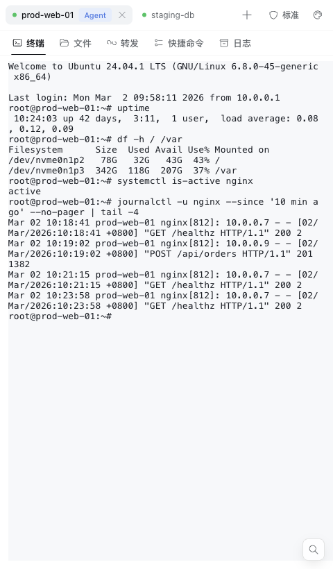
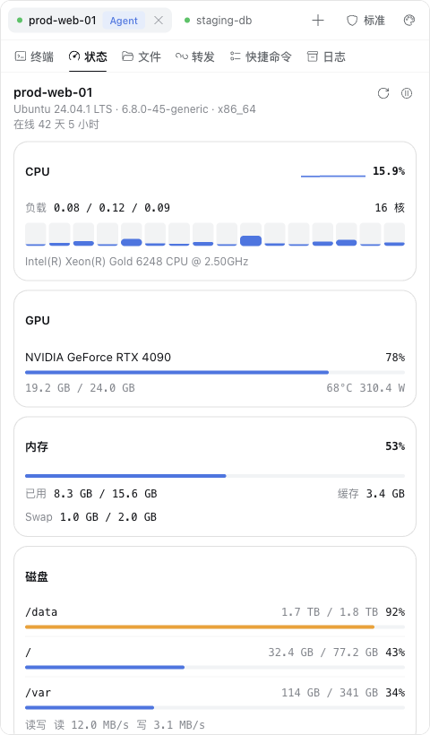

# Harbor — remote operations workbench

An SSH workbench for DeepSeek Harness: **drive a server from the conversation while a real interactive terminal stays open beside it**. Live machine status, files, port forwarding, snippets and session logs share the same panel as the chat.

> A remote machine is a first-class object, not a line in a script.

## Quick start

One entry point for install, upgrade and troubleshooting: **[INSTALL.md](./INSTALL.md)** (source, `.tgz`, local development).

Open any session, click the terminal button in the header and connect a server in the Harbor tab. Each panel is covered in the [product guide](./docs/product-guide.md).

## What it solves

Reaching a remote machine usually takes three windows: a terminal, an SFTP client, and a chat where commands get copied in and results pasted back. Harbor puts all of it on one screen:

- **One terminal per conversation, with the agent working beside you.** Say "check memory" and the command appears in the terminal in front of you — even when the agent reaches for `ssh_exec` first, Harbor opens this conversation's terminal and mirrors the command and its output into it. Exit code, output, duration, timeout and truncation state come back to the model unchanged. Once you type into that shell it is yours: the agent can keep reading, but no longer write. Two conversations on the same machine never type over each other.
- **Credentials never enter the conversation.** Servers are saved as resources; passwords and keys go only to DSH's local credential store. The model sees "the shared credential of prod-web-01", never the secret.
- **Destructive actions need your approval.** Commands that hit the safety rules suspend the tool call for a native in-session approval. An `rm` approved through `ssh_exec` performs a reversible move into a remote trash directory instead of a delete. `terminal_send` types into a live shell, where there is no rewrite point, so deletions there are permanent (see the security model, rule 3).

## Screens

| | |
| --- | --- |
| Status overview |  |
| Terminal and files |  |
| Servers and policy |  |

## Features

### Status
- One screen, five groups in a fixed order: CPU (total, load, per core), GPU (NVIDIA), memory and swap, disk usage and I/O, network throughput — plus the busiest processes and this connection's server, address and sampling cost.
- Readings come from one fixed, read-only probe on the host (`/proc`, `df`, `ps`, `nvidia-smi`): nothing to install remotely, no sudo. Every 2 seconds by default, pausable or switchable; the cadence and semantics are documented in the [product guide](./docs/product-guide.md).
- When it cannot sample it says why — non-Linux remotes, network devices without an exec channel, an exhausted sshd `MaxSessions` — and never shows 0 as a reading. "Copy snapshot" turns the current readings into text you can paste into the chat.

### Terminal
- A first-class tab in the DSH right sidebar: split, zoom, fullscreen and collapse are DSH's own. Switching tabs, collapsing the sidebar or changing chats never disconnects — terminal instances stay pooled in memory and come back with the full scrollback.
- The host keeps buffering output while nobody is watching and replays it when the panel reopens.
- Find (`Ctrl/⌘+F`, `Shift+Enter` for previous), copy-on-select, `Ctrl+wheel` zoom, jump-to-bottom. Font size and colour scheme are stored in this browser.
- Each pane keeps its own server and selection; the same server in both panes gives two independent channels.
- The connection the agent is bound to carries an "Agent" badge — click the other pane to move it there.
- Host fingerprints are TOFU, recorded per key algorithm: the first sighting of each algorithm is stored and a later change to that algorithm is rejected (a server adding another key type is not a change). `accept-new` / `verify` / `off`.

### Files
- SFTP browsing, uploads (drag and drop, directory merge), streamed downloads, rename, deletion confirmed in the panel (agent deletes through `ssh_exec` / `sftp_delete` go through recoverable remote trash), and a text editor that verifies the original content before saving and never leaves a backup file on the remote host.
- Remote search of the current directory, favourite paths, cancellable transfers that leave the target file intact when they fail, and "open this directory in the terminal" to put the terminal on the same cwd.

### Port forwarding
- Local, remote and dynamic SOCKS5 forwarding, with live bound ports and connection counts, stoppable at any time.
- Tunnels live and die with their connection: a dropped transport closes every listener, so no orphan is left behind.
- An agent-opened forward that would expose a listener — a non-loopback bind address, or any remote forward — asks first; the approval covers that one forward, and a refusal opens no socket. Loopback forwards (127.0.0.1 / ::1 / localhost) never prompt.

### Snippets
- Built-in ops commands plus your own; clicking only fills the terminal input line — Enter is still yours.
- `{{parameters}}` placeholders, scoped globally, per group or per server.

### Session logs
- Every terminal session leaves a host-side recording; the panel reads it in bounded chunks, searches it, downloads plain text and deletes per record.
- Recordings are local files; before anything reaches the model, private keys, bearer tokens, common passwords and secrets, and database connection strings are redacted.

### Servers and policy
- Groups, search, shared credentials, jump chains (up to 8 hops), OpenSSH import, encrypted backup export/import.
- Importing `~/.ssh/config` carries each host's `IdentityFile` private key along; key pickers accept extensionless files.
- Three execution-policy tiers (Standard / Custom / Allow all); a session can be loosened temporarily but the choice is **never persisted** — a reconnect falls back to the resource or global policy. The ceiling rules are in [the security model](#security-model), rule 2.
- Fixed remote project directories and remote-workspace bindings land the agent's `sftp_*` calls in the right remote directory.
- At most 32 SSH connections can be open at once; disconnecting frees a slot, and a connect past the ceiling is refused with an explanation.

## Security model

The host's own permission system comes first; Harbor only adds to it.

1. **Secrets stay local**, in `~/.dsh/.credentials.yaml` (owner-only). Browser storage, agent context, tool results and resource lists never carry plaintext.
2. **Dangerous commands suspend the call** for a native approval: deletes, `terraform destroy`, `kubectl delete`, `docker prune`, forced Git cleanups, reboots, and their common bypasses (`find -exec rm`, `xargs rm`, one-liners that call `unlink`). A command whose program name is built by expansion or command substitution (`a=r;b=m;$a$b -rf /`) cannot be judged statically and goes to the same approval. An approval covers exactly that command on that machine. An unanswered prompt is refused automatically after 120 seconds and the tool call returns. Harbor's own tier is capped by the conversation's DSH permission mode: Auto review and full access add no extra default gate, workspace write keeps the Standard approval, and read-only refuses directly.
3. **Agent deletes are reversible through `ssh_exec` / `sftp_delete`.** An approved `rm` moves the target into `~/.dsh-trash/` with its original path in the trash manifest; entries older than 24 hours are cleaned up opportunistically, and nothing is installed on the server. `terminal_send` writes straight into the PTY; Harbor cannot rewrite that line without breaking the interactive session, so a delete typed there runs as written. Deleting in the panel is an explicit permanent delete with its own confirmation.
4. **The agent sees only the current connection.** Connecting saved servers by name requires auto-connect to be enabled, and every such connection opens its terminal in the sidebar, so you always see which machine it is on.
5. **Exposed forwards need your approval.** An agent `tunnel_start` runs unprompted only for a loopback listener that is not a remote forward; `0.0.0.0`, a LAN address or any remote forward suspends the call on the same 120-second approval channel, and a refusal, cancellation, timeout or missing approval channel opens no listener. Forwards you create in the panel are unaffected.

The blacklist can never be complete — any script can hide a delete — so rule 3 backs recognition up with a reversible outcome for `ssh_exec` / `sftp_delete`; a delete typed through `terminal_send` is stopped only by recognition.

## Agent tools

22 tools are registered by default — the six host `terminal_*` tools listed below are separate and not counted. File, tunnel, status and SSH tools target the active connection when `connection_id` is omitted; `ssh_batch` and `ssh_session_log_*` use their own target selection or global log arguments. **Settings → Harbor → Feature switches** has two groups: **AI tools in the chat** can disable the tunnel, log and status tools (a DSH restart is required before they re-register), and **Right-side panel tabs** toggles the four views immediately.

Interactive terminals are not Harbor tools any more: `ssh_connect` and `ssh_connect_profile` open this conversation's panel SSH terminal automatically and reveal the machine in the right-side panel. That PTY is not a persistent-terminal registry session yet, so an agent that needs to type first calls the host's `terminal_open` (type `harbor-ssh`) to obtain the registry session id, then drives `terminal_list`, `terminal_send`, `terminal_read`, `terminal_signal` and `terminal_close`. Names, parameters, wait reasons and error codes come from the host implementation; the full rules are in the [product guide](./docs/product-guide.md).

`ssh_exec` also opens that terminal when it is missing and mirrors its command and output into it; SFTP, tunnels and `ssh_status` reveal the target server without forcing a terminal. `list` now carries `agentActive`, `agentLastActivityAt` and `agentActivityKind`; the server dot means transport reachability, the terminal glyph means this conversation has a terminal, and the pulse means the agent recently operated on it.

| Group | Tools |
| --- | --- |
| SSH (5) | `ssh_list` `ssh_connect` `ssh_connect_profile` `ssh_exec` `ssh_disconnect` |
| Terminal (host, not counted above) | `terminal_open` (type `harbor-ssh`) `terminal_send` `terminal_read` `terminal_signal` `terminal_close` `terminal_list` |
| Files (9) | `sftp_list` `sftp_read` `sftp_write` `sftp_mkdir` `sftp_rename` `sftp_delete` `sftp_upload_file` `sftp_upload_dir` `sftp_download_dir` |
| Tunnels (3) | `tunnel_start` `tunnel_stop` `tunnel_list` |
| Batch (1) | `ssh_batch` |
| Logs (3) | `ssh_session_log_list` `ssh_session_log_read` `ssh_session_log_search` |
| Status (1) | `ssh_status` |

Multi-host execution only goes through `ssh_batch`: the agent proposes the command, **you pick the targets** in the panel. There is no "name one server, run everywhere" path.

## Development

Development entry points:

- `src/index.js` — host half (composition root + RPC service); `src/terminal-backend.js` is the SSH backend row inside the official persistent-terminals group.
- `src/host/` — host services, agent tools, status sampling and pure logic; `src/rpc/` holds the Typert contract.
- `src/client/` — browser half: sidebar tab, workbench, settings page, design system and terminal appearance.
- `src/shared/` — modules both halves import; `src/i18n/` — zh/en dictionary (Chinese source, `messages.en.js` overlay).

Put a new file in the directory that owns its concern; this list is not copied per directory any more.

Build, test, preview and packaging commands live in [INSTALL.md](./INSTALL.md) under "Development commands" — that section is the only copy.

Design rules are in [docs/ui-guidelines.md](./docs/ui-guidelines.md): colours and radii resolve to the host's semantic tokens, type sizes use the six-step scale at the top of the stylesheet, and icons come from the host's own sprite (see [icon sources](./docs/icon-pipeline.md)).

## Compatibility

- Host: DSH `>= 0.2.3-alpha.2` (`engines.dsh`); interactive terminals also require the official persistent-terminals plugin.
- Requires the right sidebar (`sidebarRightTabs` + `sidebarRight`). Older hosts still run the agent tools but show no terminal UI, and there is no floating-panel fallback.
- Status sampling needs a POSIX shell and `/proc` on the remote (that is, Linux). macOS/BSD remotes and switch-like devices show "sampling not supported"; everything else keeps working.
- Streamed uploads and downloads register only when the host provides `webServer`; the registration declares `auth: "required"`, so admission (Host/Origin + browser cookie) stays with the host WebServer and the plugin does not re-implement it. Other hosts keep using plain SFTP.
- Uses DSH's bundled Node runtime; no system `ssh`, `sftp` or Node.js is required.
- Restart the profile after installing or upgrading. Resources, known hosts and credentials live in DSH's local storage, not in the package, so ordinary upgrades keep them.

## License

MIT, copyright Harbor contributors. Third-party notices in [THIRD_PARTY_NOTICES.md](./THIRD_PARTY_NOTICES.md).

Harbor is its own implementation: the package name, storage domains, environment variables, design system and UI copy are all its own, and it neither references nor depends on another DSH plugin's naming or runtime.
