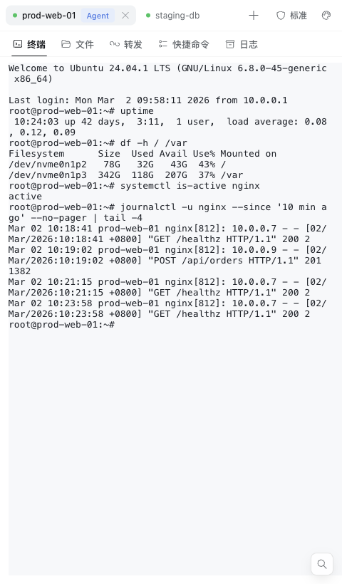
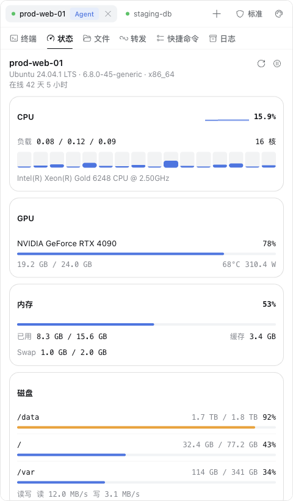
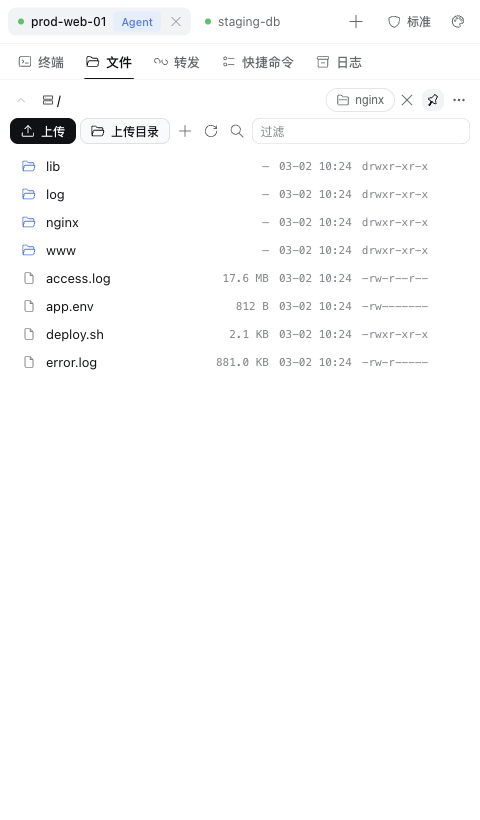
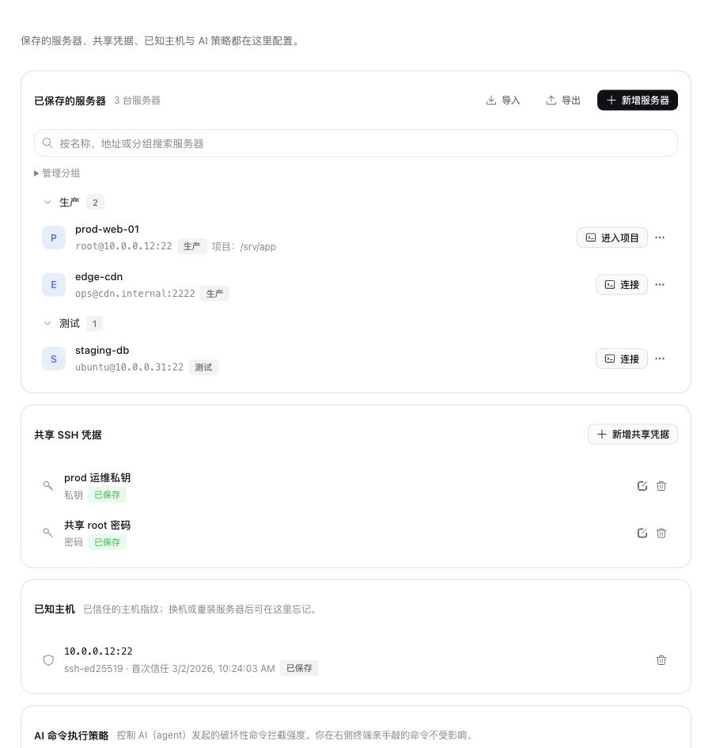

# Harbor · 远程运维工作台

DeepSeek Harness 的 SSH 工作台：**在主对话里驱动服务器，同时在右侧保留一个真正的交互式终端**——服务器状态、文件、端口转发、快捷命令与会话日志同在这块面板里，与对话并排。


> 远端机器是产品的一等对象，而不是脚本里的一段命令。



## 快速开始

```bash
git clone https://github.com/DaozeTang/dsh-harbor.git
cd dsh-harbor
npm install
dsh plugin --profile web add "$PWD"
dsh web
```

打开任意会话，点右上角的终端按钮，在「远程主机」里连接服务器。安装细节见 [INSTALL.md](./INSTALL.md)，各面板用法见[产品指南](./docs/product-guide.md)。

## 它解决什么问题

接入一台远端机器，通常要开三个窗口：终端、SFTP 客户端，以及在对话里来回复制命令和结果。Harbor 把这些收进同一块屏幕：

- **每个对话一个终端，Agent 与你在同一个终端里并肩。** 说「看下内存」，命令就出现在你面前的终端里；退出码、输出、耗时、超时与截断状态原样回到模型。两个对话同时连着同一台机器也互不干扰。
- **凭据不进对话。** 服务器保存为资源，密码与私钥只写入 DSH 本机凭据库；模型看到的是「prod-web-01 的共享凭据」，而不是那串口令。
- **破坏性操作需要你点头。** 命中规则的命令在会话内挂起等待批准；批准后的 `rm` 执行的是移入远端回收站的可逆动作，而不是删除。

## 界面

| | |
| --- | --- |
| 状态总览 |  |
| 终端与文件 |  |
| 服务器与策略 |  |

## 功能

### 状态
- 一眼看完一台机器：CPU（总量、负载、每核）、内存与 swap、磁盘用量与读写、网络吞吐、GPU（NVIDIA）、进程 Top，以及本连接的服务器、地址与采样耗时。
- 读数来自宿主侧的一条固定只读脚本（`/proc`、`df`、`ps`、`nvidia-smi`），默认 2 秒一次；切走标签、收起侧栏或窗口隐藏即停，可以暂停，也可以改成 2 / 5 / 10 秒。
- 取不到就如实说明：非 Linux 远端、没有 exec 通道的网络设备、sshd 不允许额外会话时都会给出原因，绝不用 0 冒充读数。「复制快照」把当前读数整理成一段文本，直接贴进对话。

### 终端
- DSH 右侧边栏的一等标签「远程主机」：分栏、缩放、全屏与收起都交给 DSH；切换标签、收起侧栏或切换对话都**不会断开连接**——终端实例常驻内存池，回来即恢复完整回看。
- 无人观看时宿主继续缓冲输出，重新打开时补齐。
- 查找（`Ctrl/⌘+F`，`Shift+Enter` 反向）、选中即复制、`Ctrl+滚轮` 缩放、滚到底部浮标；字号与配色保存在当前浏览器。
- 每个分栏独立维护自己显示的服务器与选中项；同一台服务器两边各开一次，得到两条互不影响的通道。
- Agent 所在的连接带「Agent」徽标，点另一栏即把 Agent 切过去。
- 主机指纹（TOFU）：首次连接记录，之后变化即拒绝；可选 `accept-new` / `verify` / `off`。

### 文件
- SFTP 浏览、上传（拖拽、目录合并）、流式下载、重命名、删除（面板内二次确认，Agent 的删除走可恢复的远端回收站）、文本编辑（保存前比对原内容，不在远端生成备份文件）。
- 远程搜索当前目录；收藏常用路径；传输可取消，失败时保留目标文件。
- 目录可「在终端打开」，把终端切到同一个 cwd。

### 端口转发
- 本地、远程、动态 SOCKS5 三种；列表实时显示绑定端口与活动连接数，随时停止。
- 隧道随连接存活，连接断开即全部关闭，不留孤儿监听。

### 快捷命令
- 内置常用运维命令，也可自定义；点击**只填入终端输入行**，按 Enter 才执行。
- 支持 `{{参数}}` 占位符与全局 / 分组 / 服务器三级作用域。

### 会话日志
- 每次终端会话在宿主侧留一份记录；面板按块读取、搜索、下载为纯文本、按条删除。
- 记录是本机文件；输出给模型前会脱敏私钥、Bearer Token、常见密码与密钥、数据库连接串。

### 服务器资源与策略
- 分组、搜索、共享凭据、跳板链（最多 8 跳）、OpenSSH 配置导入、加密备份导出与导入。
- 从 `~/.ssh/config` 导入时自动带上 `IdentityFile` 私钥；无扩展名的私钥文件（如 `1`）也能直接选择。
- 三档 AI 命令执行策略（标准 / 自定义 / 全部放行）；可临时放宽，但**不会持久化**——重连即回到资源或全局策略。
- 固定远程项目目录与远程工作区绑定，Agent 的 `sftp_*` 默认落在远端这个目录。

## 安全模型

宿主自身的权限机制优先，Harbor 只做加法。

1. **凭据只在本机。** `~/.dsh/.credentials.yaml`（owner-only）保存密码、私钥与口令；浏览器存储、Agent 上下文、工具结果与资源列表都拿不到明文。
2. **危险命令会挂起。** 删除、`terraform destroy`、`kubectl delete`、`docker prune`、强制 Git 清理、重启 / 关机等操作，连同常见绕过（`find -exec rm`、`xargs rm`、`python -c unlink` 等）都会在会话内弹出原生审批；批准只对那一条命令和那一台机器生效。
3. **Agent 的删除可逆。** 批准后执行的是 `mv` 进 `~/.dsh-trash/`（清单记录原路径）；超过 24 小时的条目在下次有新文件进入时顺带清理，服务器上不装任何定时任务。面板里的删除是显式永久删除，执行前二次确认。
4. **Agent 只看得见当前连接。** 按名称连接已保存的服务器，需要先在设置中打开「AI 自动连接」，且每次连接都会在右侧面板打开终端——你始终看得见它在哪台机器上。

黑名单无法穷尽——任何脚本都能藏住删除，所以第 3 条用可逆后果兜底，而不是只依赖识别。

## Agent 工具

默认注册 27 个工具，省略 `connection_id` 时作用于当前活动连接。**设置 → 远程主机 → 功能**可分别关闭转发、日志与状态工具（需重启 DSH）。

| 组 | 工具 |
| --- | --- |
| SSH（7） | `ssh_list` `ssh_connect` `ssh_connect_profile` `ssh_exec` `ssh_read` `ssh_write` `ssh_disconnect` |
| 终端上下文（2） | `ssh_terminal_sessions` `ssh_terminal_context` |
| Shell 集成（1） | `ssh_shell_integration` |
| 文件（9） | `sftp_list` `sftp_read` `sftp_write` `sftp_mkdir` `sftp_rename` `sftp_delete` `sftp_upload_file` `sftp_upload_dir` `sftp_download_dir` |
| 转发（3） | `tunnel_start` `tunnel_stop` `tunnel_list` |
| 批量（1） | `ssh_batch` |
| 日志（3） | `ssh_session_log_list` `ssh_session_log_read` `ssh_session_log_search` |
| 状态（1） | `ssh_status` |

多机执行只能走 `ssh_batch`：Agent 提出命令，**目标由你在面板里勾选**，不存在「点名一台、全量执行」的路径。

## 开发

```
src/
  index.js               插件入口：挂载 Remote、注册工具 / 设置页 / 侧栏标签
  rpc/                   Typert 契约：descriptors、schemas、host 清单、client 贡献
  host/
    service/             连接、会话、文件、转发、流式文件路由（按关注点拆分）
    tools/               面向 Agent 的工具注册
    *.js                 纯逻辑：安全判定、回收站、指纹、脱敏、SFTP 管道……
  client/
    index.jsx            浏览器入口：侧栏标签 + 设置页 + 会话头按钮
    HarborPanel.jsx      工作台外壳（服务器条、视图切换、面板）
    ui/                  设计系统：kit、图标、样式表
    features/            状态、终端、文件、转发、日志、快捷命令、策略
  host/monitor/          状态采样：固定探测脚本、/proc 解析、速率差分
    terminal-display/    终端配色、语义高亮、外观设置
  i18n/                  中英文消息层（中文为源语言）
```

常用命令：

```bash
npm install          # 安装依赖并构建（prepare 钩子会跑 build）
npm run build        # host + client + xterm 样式
npm test             # 单元 / 集成测试（node --test）
npm run preview:ui   # 生成离线预览页到 preview/out（浏览器打开；DSH_THEME_CSS_DIR 可指向 DSH 主题目录取实时 token）
npm run theme:snapshot -- <dsh-ui-theme>/src/styles  # 从宿主主题重生成离线 token 快照
npx eslint .
```

预览页支持 `?capture`（铺满视口的表面截图）与 `?bare`（只隐藏预览页头）。

设计约定见 [docs/ui-guidelines.md](./docs/ui-guidelines.md)：颜色、圆角、字号一律来自宿主语义 token，图标取自宿主图标集（取用方式见[图标来源](./docs/icon-pipeline.md)）。

## 兼容性

- 宿主：DSH `>= 0.2.0`（`engines.dsh`），已在 `0.2.2-rc.5` 验证。
- 必需能力：右侧边栏（`sidebarRightTabs` + `sidebarRight`）。缺这两个服务的旧宿主仍可运行 Agent 工具，但没有终端界面，也不提供浮动面板兜底。
- 状态采样需要远端提供 POSIX shell 与 `/proc`（即 Linux）；macOS / BSD 远端与交换机类设备会显示「暂不支持状态采集」，其余功能不受影响。
- 大文件流式上传 / 下载仅在 Web Profile 同时提供 `webServer` 与请求来源校验时注册，其余宿主继续走 SFTP 操作。
- 使用 DSH 内置的 Node 运行时，不要求系统另装 `ssh`、`sftp` 或 Node.js。
- 安装或升级后需完整重启对应 DSH Profile。服务器资源、已知主机与凭据存放在 DSH 本地存储中，不在插件包内，常规升级不会删除。

## 许可

MIT，版权归 Harbor contributors。第三方组件许可见 [THIRD_PARTY_NOTICES.md](./THIRD_PARTY_NOTICES.md)。

Harbor 为独立实现：包名、存储域、环境变量、设计系统与界面文案均属本项目自有，不引用也不依赖任何第三方 DSH 插件的命名或运行时。
